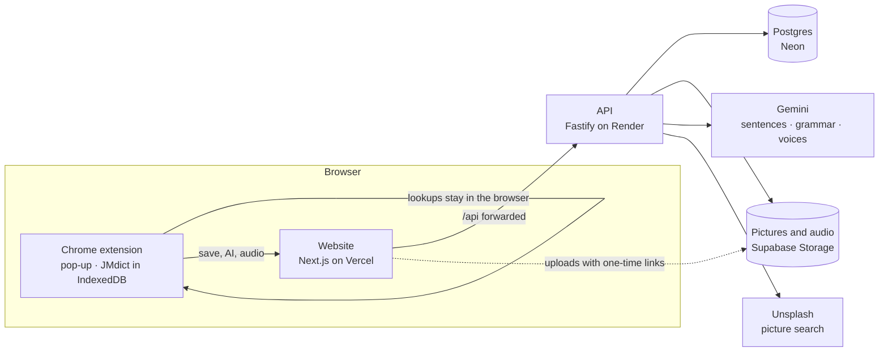

# YomiPop

[](https://github.com/MarquisPierre/YomiPop/actions/workflows/ci.yml)

Read Japanese anywhere on the web, save the words you meet, and review them on cards that come back right before you forget.

**Live:** https://yomipop.vercel.app · **Demo login:** `marquispierre27+demo@gmail.com` / `demoguy123` (sample decks are ready to review; no extension needed)


## What it does

**Chrome extension**

- Hover a word (or hold Shift) to see its reading and meanings, even for conjugated forms like 食べた → 食べる.
- Press **A** to save it as a card, with the sentence it came from and an on-device translation.
- Press **P** for the card builder: pick meanings, swap in an AI example sentence, and add a picture.
- Highlight a sentence and press **E** for an AI translation and grammar notes.
- Press **R** to hear the word in a natural AI voice.

**Website (works like Anki)**

- Decks, with reviews scheduled by **FSRS**, the algorithm modern Anki uses: Again, Hard, Good, Easy, plus undo.
- A floating card stack that flips, with audio, pictures, sentences and translations.
- A daily limit for new cards, review stats and streaks, and a light and dark theme.
- Sign-up with email verification or Google, password reset, and account deletion.

## Architecture



Lookups never leave the browser: the dictionary lives in the extension. Everything else goes through one API, which holds every key, so neither the extension nor the website ever sees one.

## Tech stack

| Part       | Technology                                                         |
| ---------- | ------------------------------------------------------------------ |
| Language   | TypeScript everywhere, in an npm workspaces monorepo               |
| Extension  | Chrome Manifest V3, Vite, JMdict (jmdict-simplified) in IndexedDB  |
| Website    | Next.js 16, React 19, Tailwind CSS 4, shadcn/ui                    |
| API        | Node 24, Fastify 5, Prisma 7                                       |
| Database   | PostgreSQL on Neon                                                 |
| Accounts   | Better Auth (email and password, Google)                           |
| Scheduling | ts-fsrs                                                            |
| AI         | Gemini (free tier): sentences, translations, grammar notes, voices |
| Pictures   | Unsplash search, plus your own uploads                             |
| Storage    | Supabase Storage                                                   |
| Hosting    | Vercel (website), Render (API)                                     |
| Quality    | Vitest, ESLint, Prettier, GitHub Actions CI                        |

## Trade-offs

Every big choice, and what it cost, is in the [decision log](docs/decisions.md). A few:

- **FSRS over SM-2:** fewer reviews for the same recall, but harder to explain.
- **Better Auth over hand-built JWTs:** secure sign-in features fast, but less control over tokens.
- **Free tiers everywhere:** the app costs nothing to run, but the API sleeps when idle, and AI has daily limits.

## Running it locally

You need Node 24, PostgreSQL, and Chrome.

```bash
npm install
npm run build:dict                         # downloads JMdict and builds the extension's dictionary
cp apps/api/.env.example apps/api/.env     # then fill it in (below)
cd apps/api && npx prisma migrate deploy && cd ../..
npm run dev                                # API on :4000, website on :3000, extension on :5173
```

Then load the extension: `chrome://extensions` → Developer mode → **Load unpacked** → `apps/extension/dist`.

**`apps/api/.env`**

| Setting                                     | What it's for                                                           |
| ------------------------------------------- | ----------------------------------------------------------------------- |
| `DATABASE_URL`                              | Your Postgres database                                                  |
| `BETTER_AUTH_SECRET`, `BETTER_AUTH_URL`     | Sign-in (the URL is the website's, e.g. `http://localhost:3000`)        |
| `GOOGLE_CLIENT_ID`, `GOOGLE_CLIENT_SECRET`  | Optional: "Continue with Google"                                        |
| `EMAIL_SCRIPT_URL`, `EMAIL_SCRIPT_SECRET`   | Optional: sending email. Without them, emails print in the API's log.   |
| `GEMINI_API_KEY`                            | AI sentences, grammar notes and voices                                  |
| `UNSPLASH_ACCESS_KEY`                       | Picture search                                                          |
| `SUPABASE_URL`, `SUPABASE_SERVICE_ROLE_KEY` | Audio and uploaded pictures (buckets `audio`, `avatars`, `card-images`) |

Every AI and storage feature falls back gracefully without its key: the app still runs.

**Checks:** `npm run lint`, `npm run format:check`, `npm run typecheck`, `npm test`. CI runs all of these, and the builds, on every push.

## What's next

- Phase 8 of the plan: suspend and bury, tags, a stats heatmap, CSV import and export, and installing the website as a phone app.
- API tests against a real database, including "user A can't read user B's cards".
- Error monitoring with Sentry, and an uptime check.
- Publishing the extension to the Chrome Web Store.
